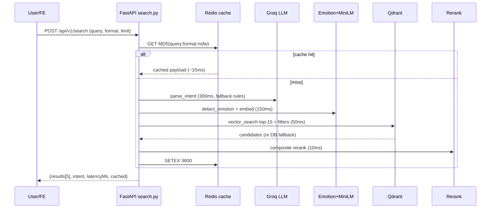

# 02 — Architecture & Stack

## 2.1 System overview (legacy: 02_Project_Architecture/, 12 files)
```text
┌─────────────┐     ┌──────────────────┐     ┌─────────────────────────┐
│ Vite SPA    │     │ Next.js 14       │     │ Expo 51 mobile          │
│ app.* :5173 │     │ memegpt.com :3000│     │ iOS 15+ / Android 10+   │
└──────┬──────┘     └────────┬─────────┘     └────────────┬────────────┘
       └─────────────┬──────┴────────────────┬───────────┘
                     ▼                       ▼
          ┌──────────────────────────────────────────┐
          │ FastAPI 3.11  api.* :8000                │
          │ CORS → rate-limit → logger → error handler│
          │ 34 routers (/api/v1/*) + legacy /api     │
          │ APScheduler jobs · Sentry · lifespan ML  │
          └──────┬───────┬────────┬────────┬─────────┘
                 ▼       ▼        ▼        ▼
        ┌──────────┐ ┌───────┐ ┌──────┐ ┌──────────┐
        │ Qdrant   │ │ PG /  │ │Redis │ │ R2 CDN   │
        │ vectors  │ │SQLite │ │cache │ │ media    │
        └──────────┘ └───────┘ └──────┘ └──────────┘
```
Stateless API (horizontal scale via multi-worker/Gunicorn). All external calls have timeouts + fallbacks — **no single vendor outage may break search** (degrades to DB matcher).

## 2.2 ADRs (legacy: Architecture_Decisions.md)
| Decision | Chosen | Rejected | Why |
|---|---|---|---|
| API framework | FastAPI (async, Pydantic, `/docs`, ~2100 rps) | Flask (~700 rps), Django (heavy) | ML-serving throughput + validation + auto-docs |
| Vector DB | Qdrant Cloud 1GB free (~1M vectors), named vectors, payload filters | Pinecone (paid), Chroma (weak ops), pgvector (10× slower ANN) | Free + filtered cosine + HNSW |
| Cache/rate | Upstash Redis + in-memory fallback | In-process only | Shared counters across workers + 1h result TTL |
| Relational | SQLite WAL dev → Postgres prod (SQLAlchemy) | Supabase client lock-in | Zero-config local, standard SQL prod |
| Media | Cloudflare R2 10GB zero-egress | S3 (egress fees) | Free bandwidth for GIF/MP4 |
| LLM intent | Groq `llama-3.1-8b-instant` 6k/d free ~300ms | OpenAI (paid), Ollama (unhosted) | Free + fast + JSON mode |
| Embeddings | MiniLM-L6-v2 80MB 384d ~50ms | mpnet 420MB 5× slower | Fits 512MB RAM budget |

## 2.3 Request lifecycle (legacy: Request_Flow.md, ~500ms server / ~1.2s E2E)
1. **Validate (≤50ms):** Pydantic (`query 1–2000`, `limit 1–20`, enums) → sanitize (HTML-strip, null-byte kill, Unicode NFKC, truncate 2000/512).
2. **Cache (~15ms hit):** `GET MD5(query:format:nsfw)` — target >50% hit rate.
3. **Parallel AI:** Groq intent JSON (temp 0.1, ≤300 tok, 5s timeout) ∥ DistilRoBERTa emotion (CPU, ≤512 chars); either may fail → rule-based fallback (multilingual EN/ES/PT/HI).
4. **Enrich + embed (~50ms):** `build_query_text(user + situation + emotion + tone + keywords + format)` → MiniLM L2-normalized 384d (zero-vector guarded).
5. **Retrieve (~50ms):** Qdrant named-vector `text` cosine top-15 with `nsfw/format/categories/exclude_ids` filters; threshold cascade 0.45→0.35→0.2; <3 hits → DB augment; 0 hits → popularity fallback.
6. **Rerank (~10ms):** composite score (see `03-`) → top-5 + alternatives + GIF list + viral picks.
7. **Respond + persist:** `SETEX 3600` + `BackgroundTasks` (`search_logs` MD5, no PII; usage counters) → CDN WebP-thumb `preview_url` + `share_url /meme/{slug}`.

## 2.4 Offline indexing (weekly, ~30min/10k)
`collect (Imgflip/Reddit/Giphy/Tenor) → clean (NSFW skip, 5KB–10MB, hash dedup) → OCR (Tesseract psm6/oem3) + BLIP caption + Groq tags → 100–200tok rich text → MiniLM 384d + CLIP 512d → combined 896d (0.65 text + 0.35 image, L2-norm) → Qdrant upsert batch 50–100 → R2 upload + WebP thumbs → seed DB → verify_index → evaluate`.

## 2.5 Full stack & versions
- **FE:** React 19, Vite 6, TS strict, Zustand 5 (client), TanStack Query 5 (server), RHF 7, Framer Motion 13, Lucide, canvas-confetti; Next 14 App Router + Tailwind; Expo ~51 + Router 3.5 + Reanimated + Paper + RN 0.74.
- **BE (`backend/requirements.txt`):** `fastapi>=0.111,<1`, `uvicorn[standard]`, `pydantic(+settings)`, `python-multipart`, `python-jose`, `passlib[bcrypt]`, `bcrypt`, `sqlalchemy>=2,<3`, `alembic`, `qdrant-client>=1.9,<2`, `redis>=5,<6`, `upstash-redis`, `sentence-transformers>=2.7`, `transformers>=4.40`, `torch>=2.2`, `pillow`, `pytesseract`, `numpy>=1.26,<2`, `scikit-learn`, `groq>=0.8`, `httpx`, `requests`, `boto3/botocore`, `apscheduler`, `sentry-sdk[fastapi]`, `pytest(+asyncio,+cov)`, `flake8`, `black`.
- **Models:** MiniLM-L6-v2 · `j-hartmann/emotion-english-distilroberta-base` · Groq llama-3.1-8b-instant · `openai/clip-vit-base-patch32` (indexing) · `Salesforce/blip-image-captioning-base` (indexing) · Tesseract 5.
- **Infra:** Vercel (FE) · Railway/Render (BE) · Qdrant Cloud · Supabase PG · Upstash Redis · R2 · GitHub Actions (9 workflows) · UptimeRobot · Sentry.

## 2.6 Sequence diagram (search)


## 2.7 Capacity envelope (free tiers → first paid trigger)
| Resource | Free cap | Usage @10k DAU | First upgrade trigger |
|---|---|---|---|
| Vercel bandwidth | 100 GB | ~30 GB (WebP thumbs) | >100 GB 2 weeks |
| Railway hours | 750 h | 1 instance ~720 h | 2nd worker needed |
| Qdrant storage | 1 GB (~1M × 896d) | ~50 MB @50k memes | >500k memes |
| Supabase DB | 500 MB | ~100 MB @50k + logs | 30-day purge keeps flat |
| Upstash commands | 10k/day | ~8k (cache+rate) | Raise TTL / local fallback |
| R2 storage | 10 GB | ~3 GB @50k thumbs | Lifecycle to Infrequent |
| Groq requests | 6k/day | ~4k (cache absorbs) | Temp 0.1 + shorter prompts first |
